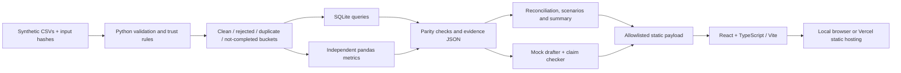

# Evidence Room

> Revenue dropped in September 2026 versus August 2026. Is it a real business change or a data problem?

Evidence Room investigates messy synthetic order exports using explicit trust rules,
independent pandas and SQL calculations, and traceable results. Its static website
presents the investigation with reconciliation tables, rejection receipts, scenario
comparisons and verified AI claims.

**[Open the live demo](https://evidence-room-tawny.vercel.app)** ·
[Architecture](docs/ARCHITECTURE.md) · [Findings](executive_summary.md) ·
[Verification status](docs/STATUS.md)

## What the supplied data shows

| Measure | August 2026 | September 2026 |
|---|---:|---:|
| Trusted completed revenue (INR) | 1,809,000.00 | 1,137,400.00 |
| Trusted orders | 113 | 84 |

Trusted revenue declines **37.13%**. Of 244 source rows, 197 are trusted, 14
rejected/quarantined, 30 not completed and 3 removed as identical duplicates.
These are computed results from [KPIs](results/kpis.json), not evidence of a
particular business cause. Conditional repair scenarios retain the decline;
unknown corrections and missing transactions remain outside those bounds.

## Requirements

- **Python 3.11** for the pinned analysis/test environment; SQLite is included in Python.
- **Node.js 22 and npm** for the website only.
- **Git** to clone the project, or use GitHub's **Code → Download ZIP** and extract it.
- **Google Chrome** only for the optional browser audit.
- Internet access for cloning/installing dependencies. Analysis, tests and the built
  website then run locally without an API key, database server, account or paid service.

Run commands from the repository root unless a step says otherwise. Installing
Python/Node does not require enabling any cloud billing.

## 1. Get the project

```sh
git clone https://github.com/tulasiram2005/evidence-room.git
cd evidence-room
```

If you downloaded the ZIP, open a terminal in the extracted folder containing
`analysis.py`. The extracted directory may be named `evidence-room-main`.

## 2. Reproduce the analysis

### macOS / Linux

```sh
python3.11 -m venv .venv
source .venv/bin/activate
python -m pip install -r requirements-dev.lock
python analysis.py
python tools/check.py
```

### Windows PowerShell

These commands use the environment's Python directly, so PowerShell activation or
execution-policy changes are not needed.

```powershell
py -3.11 -m venv .venv
.\.venv\Scripts\python.exe -m pip install -r requirements-dev.lock
.\.venv\Scripts\python.exe analysis.py
.\.venv\Scripts\python.exe tools/check.py
```

Expected analysis output includes the four bucket counts above and `"parity": "passed"`.
The saved test report currently records **46 passing tests**, zero failures/errors
and zero skipped tests. Your command must exit successfully; inspect errors rather
than assuming a previous saved report represents your run.

The pipeline regenerates CSVs, SQL, the management summary, JSON evidence and
`web/src/evidence.json`. It verifies the raw input hashes and must not silently
accept edited source CSVs. Rerun it before rebuilding the website after code changes.

## 3. Run the website on your laptop

From the repository root, after the analysis:

```sh
cd web
npm ci
npm run build
```

Then start the local static server:

**macOS / Linux** (with the Python environment still active):

```sh
python -m http.server 4173 --bind 127.0.0.1 --directory dist
```

**Windows PowerShell:**

```powershell
..\.venv\Scripts\python.exe -m http.server 4173 --bind 127.0.0.1 --directory dist
```

Open **http://127.0.0.1:4173/**. Keep this terminal open; press **Ctrl+C** to stop.
Do not double-click `dist/index.html`: use the HTTP server so assets resolve correctly.
For UI development instead, run `npm run dev` from `web` and open the address it prints.

### Explore the investigation

1. Read the verdict and the data-health counts.
2. Expand the monthly reconciliation and review the trust decisions.
3. Filter quarantine receipts by reason.
4. Compare monthly revenue and new/repeat contribution.
5. Select a sensitivity scenario to update the comparison.
6. Open AI claim evidence and use **Print the evidence** for the management note.
7. Switch between Ledger Paper and Night Desk with the theme button.

The website contains bundled aggregates and a limited rejection log. It does not
serve full raw/clean CSVs, run Python in the browser, or contact an AI provider.

## Architecture



See [the detailed architecture](docs/ARCHITECTURE.md) for module responsibilities,
optional provider boundaries and the deployment flow.

## Technology stack

| Layer | Technologies actually used |
|---|---|
| Analysis | Python 3.11, pandas, Decimal parsing, integer INR paise, standard-library SQLite |
| Verification | unittest, Hypothesis, independent SQL/pandas parity, SHA-256 input/output hashes |
| Website | React 18.3.1, TypeScript 5.7.3, Vite 6.4.5, handwritten CSS, custom SVG charts |
| Browser quality | Playwright with Chrome, axe-core, Lighthouse, contrast checks |
| Security/quality | Ruff, Bandit, pip-audit, npm audit, build-content and repository-history scanners |
| Optional AI | Gemini REST function calling, local Ollama JSON transport, deterministic mock fallback |
| Delivery | Git/GitHub, manual GitHub Actions workflow, Vercel Hobby static hosting |

Python dependencies are pinned in `requirements-dev.lock`; web dependencies are
pinned in `web/package.json` and `web/package-lock.json`.

## Files and outputs

| Path | Purpose |
|---|---|
| `data/raw/`, `data/raw.sha256` | Original synthetic inputs and integrity hashes |
| `src/evidence/` | Rules, metrics, scenarios, summary, tools, provider and claim-check code |
| `analysis.py` | Offline pipeline entry point |
| `queries.sql`, `sql/queries.sql` | SQLite queries executed by the pipeline |
| `clean_orders.csv` | Trusted completed orders with INR paise and lineage |
| `rejected_orders.csv` | Other dispositions, original fields and reason codes |
| `executive_summary.md` | Generated management findings and next action |
| `ai_verification.md` | Actual draft, evidence checks and review section |
| `results/` | Computed metrics, hashes, test/security reports and browser evidence |
| `tests/`, `tools/` | Automated checks, optional drafting and packaging commands |
| `web/` | Static website source, build configuration and browser audit |
| `docs/` | Architecture, decisions, assumptions, limitations and reproducibility evidence |

## Additional verification

From the repository root, using the activated Python environment (or the Windows
`.\.venv\Scripts\python.exe` prefix):

```sh
python tools/check.py
python tools/contrast.py
python tools/build_gate.py
python tools/publication_check.py
```

`build_gate.py` requires the website to have been built. The history check requires
a Git clone; it cannot inspect history in a downloaded source ZIP.

For the browser audit, keep the static server on port 4173 running. In a **second
terminal**, enter the project's `web` directory and run:

```sh
node tests/browser.mjs local-check
```

This requires installed Google Chrome. It writes `results/ui-local-check.json`,
updates `results/ui.json`, and captures screenshots under `results/screenshots/local-check/`.
It checks both themes at four viewport sizes, scenarios, filtering, overflow, axe
violations, console errors and external requests.

Optional Lighthouse measurement from `web`:

```sh
npx --no-install lighthouse http://127.0.0.1:4173/ --chrome-flags="--headless" --output=json --output-path=../results/lighthouse-local.json --quiet --no-enable-error-reporting
```

Recorded local Lighthouse scores were performance 100, accessibility 100, best
practices 100 and SEO 82 before metadata fixes. Automated accessibility checks
are not a substitute for human screen-reader testing. See [status](docs/STATUS.md)
for the precise scope and remaining unverified requirements.

## Optional AI providers

The default pipeline uses a **deterministic mock**, so it remains reproducible and
needs no key. Real providers are opt-in and never change the trusted finance results.
See [provider setup](docs/PROVIDERS.md) before enabling them. Gemini requires an
explicitly verified free-tier project/model and environment-only credentials;
Ollama requires a locally available model. Never paste keys into source or commit them.
Native tool calling is implemented and tested with simulated responses; live validation
has not been completed. Project assistance and verification are documented in the
assessment-required [AI disclosure](docs/AI_DISCLOSURE.md).

## Troubleshooting

| Problem | What to do |
|---|---|
| `python3.11` or `py -3.11` not found | Install Python 3.11, reopen your terminal and check its version. |
| Missing Python package | Install the lock file using the same environment's Python that runs analysis. |
| `npm` not found | Install Node.js 22 with npm, then reopen the terminal. |
| Browser says connection refused | Start the static server in `web` and leave its terminal open. |
| Port 4173 is already in use | Use the existing preview if it is this project, or stop that server before restarting. |
| Page/assets return 404 | Run `npm run build` in `web`; serve that directory's `dist` folder. |
| Browser audit cannot launch Chrome | Install Google Chrome; on restricted systems run the audit in your own Terminal. |
| Raw input integrity error | Restore the original supplied files. Do not bypass the hash guard to hide edits. |
| Website shows older results | Rerun analysis from the root, rebuild in `web`, then refresh the browser. |

## Packaging and deployment

From the repository root, run `python tools/package.py` (use the environment's
Python path on Windows). It writes `Evidence_Room_Submission.zip` in the **parent
folder**, including code, data, documentation and captured evidence; dependencies,
private provider-run files and environment files are excluded.

The public repository is linked to Vercel with `web` as the project root and
`dist` as output. Pushes trigger a static build. See [deployment instructions](docs/DEPLOY_FREE.md)
and [free-tier policy](docs/FREE_TIER_BUDGET.md). No runtime database or server is needed.

## Scope and limitations

Only supplied August–September 2026 records are analyzed. New/repeat means first
valid order **within this window**, not lifetime tenure. USD uses the supplied
85 INR assumption; unsupported currencies are not assigned an invented rate.
Naive reconciliation bases mix currency face values and must not be read as INR.
Row coverage is a data-quality indicator, not a probability that the conclusion is true.

Read [decisions](docs/DECISIONS.md), [limitations](docs/LIMITATIONS.md),
[security controls](docs/SECURITY.md) and [third-party licenses](THIRD_PARTY_LICENSES.md).
The original [challenge brief](docs/challenge_readme.md) is retained as the project's
requirements reference. Personal planning prompts and unrelated projects are not
part of this repository.
