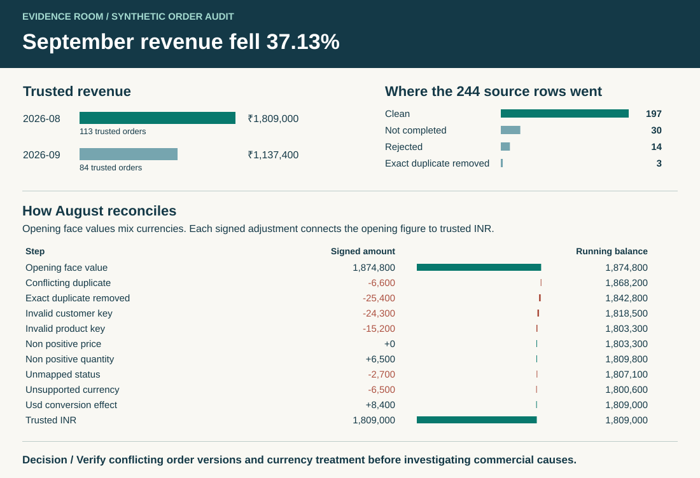

# Evidence Room · Revenue review

**September's trusted completed revenue fell 37.13% in the synthetic order export.** Finance can use the reconciliation to decide which exceptions to resolve before investigating the commercial cause.

| Open the analysis | What to inspect |
|---|---|
| [Power BI project (ZIP)](./Power-BI.zip?raw=true) | Extract the folder, open Evidence.pbip in Power BI Desktop on Windows, then select **Refresh**. The self-contained import model supplies the two monthly totals, August adjustments and row dispositions to three native visuals. |
| [Tableau workbook (TWBX)](./Evidence-Room.twbx?raw=true) | Open in Tableau Desktop or Tableau Public Desktop and select **Revenue review**. The package includes the dashboard, its three worksheets three embedded Hyper extracts and their CSV source tables. |
| [Excel audit (XLSX)](./Revenue-audit.xlsx?raw=true) | Open **Review** for the totals. Filter **Row audit** to see the source record and decision, inspect the running balance in **Reconciliation**, or compare assumptions on **Repair scenarios**. |

**Verification.** The packaged workbook opened in Tableau Public Desktop on macOS. The Power BI project and report definitions passed Microsoft JSON schema checks. Its Windows Desktop render remains unverified. The saved Excel workbook was reopened and its cached totals, bridge balance and decomposition residual were checked.

## What accounts for the ₹671,600 gap?

A symmetric decomposition in Excel splits the decline into **₹428,465 from the change in trusted order count** and **₹243,135 from the change in average trusted order value** (rounded to the nearest rupee). Each contribution uses the average of the other factor across the two months, so the contributions sum to the observed change. The calculation identifies where to investigate and leaves the commercial cause open.

## What changes the decision?

August contributed 113 trusted orders and September contributed 84. The accepted records support a decline of ₹671,600. Across the two combined known-currency repair scenarios, the decline ranges from ₹646,400 to ₹728,800. This sensitivity check uses supplied positive amounts, permits at most one version of a conflicting order and keeps exact duplicates excluded. Missing transactions or arbitrary corrected prices could change the result.

The waterfall starts with a sum of **mixed-currency face values** and ends with trusted INR. Only the closing value is a trusted monetary total. A positive adjustment can result from removing a negative quantity. September's starting and closing figures coincide. The row counts cover the entire export, including unassignable dates.

**Decision for Finance.** Resolve conflicting versions against the order ledger, confirm unsupported currency treatment, and rerun the reconciliation. Investigating the cause of the remaining decline would require evidence such as traffic and conversion, stock availability, or promotion dates.

[Monthly figures and quality buckets](../results/kpis.json) · [Waterfall inputs](../results/waterfall.json) · [Sensitivity assumptions and bounds](../results/flip.json) · [Row classification logic](../src/evidence/pipeline.py)
