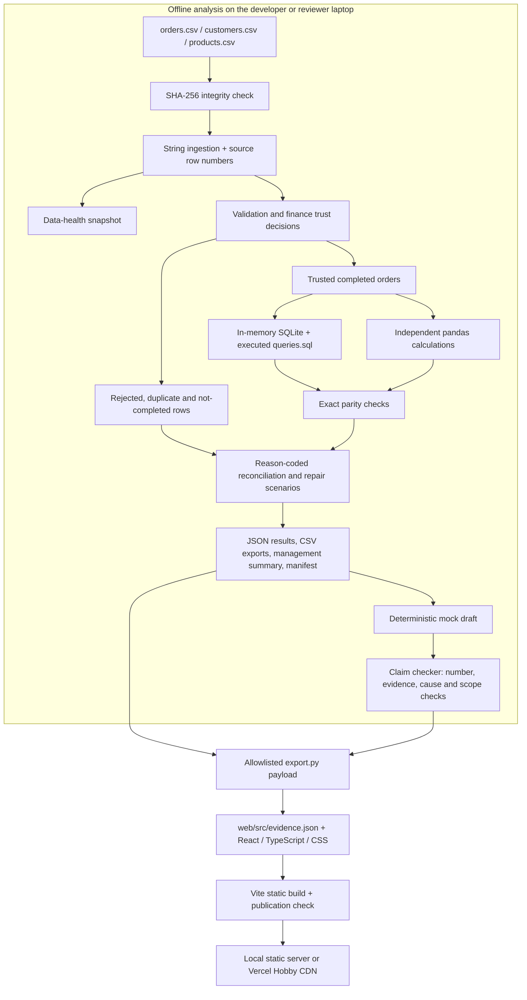
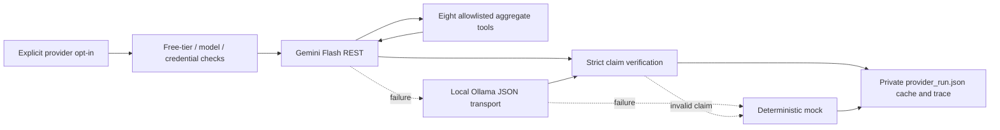

# Evidence Room architecture

Evidence Room separates offline computation from static presentation. Python
produces the evidence; the browser renders a checked subset. There is no hosted
Python API, database service, authentication service or runtime model connection.

## Data flow and verification

The rule engine partitions every raw row into exactly one disposition. The sum
must equal the input row count. Money is parsed with Decimal and retained as
integer INR paise. SQL and pandas results must agree before publication. The
pipeline records source/output hashes; repeat runs are tested for determinism.

## Optional provider path

Provider transport is separate from `analysis.py`. Gemini native calls allow at
most three rounds and eight tool calls. Tool names and arguments are validated;
no model-supplied shell commands, SQL or arbitrary paths are executed. Model
messages preserve function-call IDs and thought signatures. Only aggregate
results and evidence references are returned to the model. Transport uses bounded
responses, timeouts and retries; failed or unverified drafts fall back.

The committed analytical evidence uses the deterministic mock. Live-model
validation remains unmeasured. See [provider details](PROVIDERS.md).

## Implementation map

| Component | File | Responsibility |
|---|---|---|
| Entry point | `analysis.py` | Run the offline pipeline |
| Core pipeline | `src/evidence/pipeline.py` | Ingestion, health, trust rules, exports, SQL and parity |
| Sensitivity | `src/evidence/sensitivity.py` | Explicit repair scenarios and conditional bounds |
| Summary | `src/evidence/summary.py` | Generate traceable management text |
| Default draft | `src/evidence/ai.py` | Deterministic claims and verification report |
| Tool interface | `src/evidence/ai_tools.py` | Strict read-only aggregate schemas and evidence pointers |
| Provider orchestration | `src/evidence/providers.py`, `native_tools.py` | Opt-in transport, native loop, cache and fallback |
| Claim verification | `src/evidence/verify.py` | Schema, factual and numerical checks |
| Website boundary | `src/evidence/export.py` | Export allowed fields into static JSON |
| Presentation | `web/src/main.tsx`, `style.css` | Narrative sections, charts, receipts and interactions |
| Publication gate | `tools/build_gate.py` | Reject forbidden files/content in static output |

## Security and publication boundaries

- The public Git repository contains synthetic source data, reproducible code,
  project documentation and test evidence. It contains no personal master prompts.
- The website contains aggregates and selected rejection fields. Full raw/clean
  CSVs stay outside the deployed output.
- Keys belong in environment variables; private provider logs and `.env` files
  are excluded from Git and the submission archive.
- Browser policy disallows runtime connections (`connect-src 'none'`); scripts,
  styles and fonts are same-origin. No analytics or third-party CDN assets are used.
- Vercel builds the `web` directory and serves `dist`; it does not rerun the Python
  analysis. Developers regenerate `web/src/evidence.json` locally before pushing
  changes that affect results.
- The manual GitHub Actions workflow performs verification; a hosted successful
  run is not yet part of the measured evidence.

## Evidence and known boundaries

[Tests](../results/test_report.json), [parity](../results/parity.json),
[browser audit](../results/ui.json), [Lighthouse](../results/lighthouse.json) and
[hosted HTTP checks](../results/hosted_smoke.json) provide distinct evidence.
Local UI success does not prove hosted interaction success. See
[implementation status](STATUS.md) for outstanding work.
